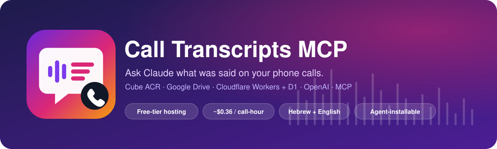
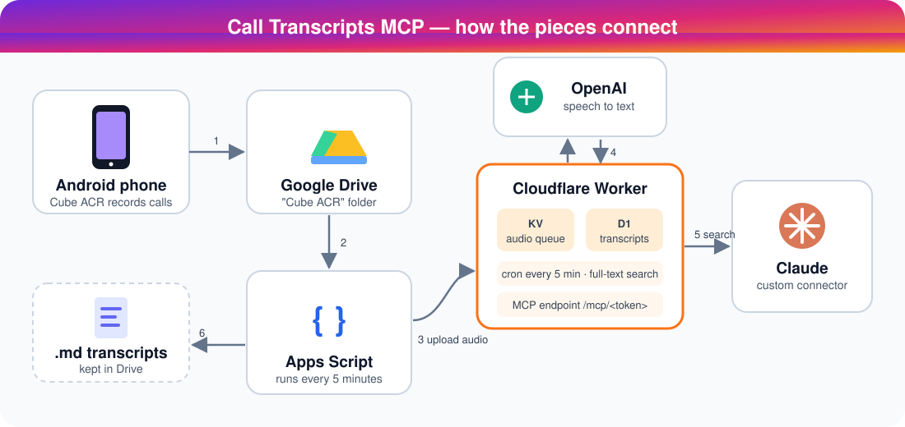
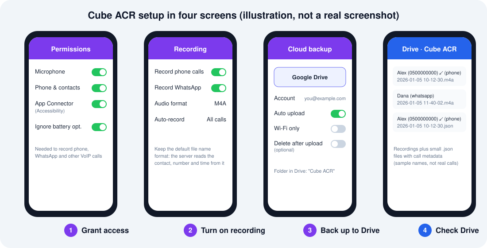
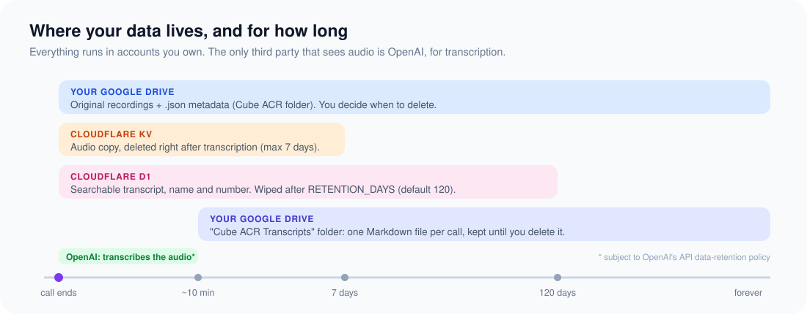

<p align="center">
  
</p>

<p align="center">
  <a href="README.md">English</a> · <b>עברית</b> · <a href="AGENTS.md">מדריך התקנה לסוכן AI</a>
</p>

<div dir="rtl">

# תמלול שיחות טלפון לקלוד

מקליטים שיחות טלפון ווטסאפ עם **Cube ACR** באנדרואיד, הן מתומללות אוטומטית ב-**OpenAI**, ואפשר לחפש בהן מתוך **קלוד** דרך מחבר MCP. שואלים למשל *"על מה סיכמתי עם אלכס לגבי מועד המשלוח?"* ומקבלים תשובה עם השיחה, התאריך והשעה.

הכל רץ בחשבונות שלכם: הדרייב, חשבון Cloudflare (בשכבה החינמית) ומפתח OpenAI. העלות היחידה היא התמלול, בערך **0.006 דולר לדקת שיחה** (כ-36 סנט לשעת שיחות).

> [!TIP]
> **אפשר לתת לסוכן לעשות את זה.** פותחים את הריפו ב-Claude Code (או בכל סוכן קוד) ואומרים לו:
> *"תתקין לי את זה לפי AGENTS.md"*. הסוכן מריץ את הפקודות ועוצר רק בשלבים שרק אדם יכול לעשות: האפליקציה בטלפון, ההתחברויות ומפתח ה-API.

## איך זה עובד

</div>

<p align="center"></p>

<div dir="rtl">

1. **Cube ACR** מקליט כל שיחה בטלפון ומעלה אותה לתיקייה בגוגל דרייב.
2. **Apps Script** קטן בחשבון הגוגל שלכם בודק את התיקייה כל 5 דקות.
3. הוא שולח הקלטות חדשות ל-**Cloudflare Worker**, שמחזיק אותן בתור ב-KV.
4. כל 5 דקות ה-Worker מתמלל את התור ב-OpenAI, שומר את הטקסט ב-D1 עם חיפוש מלא, ומוחק את האודיו. שיחות מעל 5 דקות נחתכות קודם לחלקים של עד 4.5 דקות, כי המודל מפסיק לכתוב אחרי כ-10 דקות דיבור בעברית.
5. **קלוד** מתחבר ל-Worker ומקבל שישה כלים: `search_calls`, `list_calls`, `get_transcript`, `sync_status`, `sync_now`, `check_truncated`.
6. ה-Apps Script שומר כל תמלול גם כקובץ Markdown בדרייב, כך שנשאר עותק קבוע.

## מה צריך

- טלפון **אנדרואיד** עם Cube ACR. גיבוי לענן דורש את גרסת ה-Premium. באייפון אי אפשר להקליט שיחות כך.
- חשבון **גוגל** (דרייב ו-Apps Script).
- חשבון **Cloudflare** (חינם).
- **מפתח OpenAI** עם קרדיט.
- **קלוד** בתוכנית שתומכת במחברים מותאמים אישית.
- **Node.js 18** ומעלה במחשב, רק בשביל הפריסה.

> [!IMPORTANT]
> **חוקיות ההקלטה.** הכללים להקלטת שיחות שונים ממדינה למדינה, ובחלק מהמקומות כל המשתתפים צריכים להסכים. בדקו מה חל עליכם ועל מי שאתם מדברים איתו.

## התקנה צעד אחר צעד

### 1. Cube ACR בטלפון

</div>

<p align="center"></p>

<div dir="rtl">

1. מתקינים את **Cube ACR** מ-Google Play ופותחים.
2. **הרשאות:** מאשרים מיקרופון, טלפון ואנשי קשר. כשהאפליקציה מבקשת, מפעילים את **Cube ACR App Connector** בהגדרות הנגישות (Accessibility) של אנדרואיד. זה נדרש להקלטת שיחות ווטסאפ. כדאי גם לפטור את האפליקציה מחיסכון בסוללה, אחרת אנדרואיד עלול לעצור אותה ברקע.
3. **הקלטה:** בהגדרות של Cube ACR מוודאים ששיחות טלפון (וגם ווטסאפ, אם רוצים) מוקלטות אוטומטית. משאירים את **פורמט שם הקובץ כברירת המחדל**, כי השרת קורא ממנו את שם איש הקשר, המספר, הכיוון והשעה.
4. **גיבוי לדרייב:** ב-*Settings ← Cloud backup* (השם משתנה מעט בין גרסאות) בוחרים **Google Drive**, מתחברים עם אותו חשבון גוגל שבו יותקן ה-Apps Script, ומפעילים העלאה אוטומטית. *מחיקה אחרי העלאה* היא אופציונלית.
5. **בדיקה:** עושים שיחת ניסיון קצרה. אחרי כמה דקות מופיעה בדרייב תיקייה בשם **Cube ACR** עם קובץ `.m4a`. פותחים אותה ומעתיקים את **מזהה התיקייה**, החלק האחרון בכתובת: `drive.google.com/drive/folders/`**`החלק_הזה`**.

### 2. פריסת ה-Worker ב-Cloudflare

</div>

```bash
git clone https://github.com/Ben-Rotenberg/call-transcripts-mcp.git
cd call-transcripts-mcp
npm install
npx wrangler login                                        # נפתח דפדפן להתחברות ל-Cloudflare
npx wrangler kv namespace create call-transcripts-audio   # מעתיקים את ה-id
npx wrangler d1 create call-transcripts                   # מעתיקים את ה-database_id
```

<div dir="rtl">

פותחים את `wrangler.jsonc` ומחליפים את `<YOUR_KV_NAMESPACE_ID>` ואת `<YOUR_D1_DATABASE_ID>` בשני המזהים. אם השיחות לא בעברית, משנים גם את `TRANSCRIBE_LANGUAGE` (למשל `en`). אחר כך מוסיפים את הסודות ופורסים:

</div>

```bash
npm run token                              # מייצר טוקן אקראי. שומרים אותו
npx wrangler secret put MCP_TOKEN          # מדביקים את הטוקן
npx wrangler secret put OPENAI_API_KEY     # מדביקים את מפתח OpenAI
npx wrangler deploy                        # מדפיס את כתובת ה-Worker
```

<div dir="rtl">

פותחים את הכתובת בדפדפן. אמורה להופיע ההודעה *"Phone Calls MCP is running."*. הטבלאות במסד הנתונים נוצרות לבד.

### 3. התקנת ה-Apps Script

1. נכנסים ל-[script.google.com](https://script.google.com) עם **אותו חשבון גוגל** ש-Cube ACR מעלה אליו, ולוחצים **New project**.
2. מחליפים את התוכן של `Code.gs` בקובץ [`apps-script/Code.gs`](apps-script/Code.gs).
3. ב-*Project Settings* (גלגל השיניים) מסמנים **Show "appsscript.json" manifest file in editor**, ומחליפים את הקובץ ב-[`apps-script/appsscript.json`](apps-script/appsscript.json).
4. באותו מסך מוסיפים **Script Properties**:
   - `WORKER_URL`: כתובת ה-Worker משלב 2
   - `MCP_TOKEN`: הטוקן משלב 2
   - `DRIVE_FOLDER_ID`: מזהה התיקייה משלב 1
   - `ALERT_EMAIL` (לא חובה): לאן לשלוח מייל אם נגמר הקרדיט ב-OpenAI
5. בעורך בוחרים את הפונקציה `setup` ולוחצים **Run**, ומאשרים את ההרשאות. זה מריץ סנכרון ראשון ומתקין טריגר כל 5 דקות.

הריצה הראשונה חוזרת 120 יום אחורה, כך שאם יש הרבה הקלטות זה ייקח זמן (כ-10 הקלטות כל 5 דקות).

### 4. בדיקה

אחרי 5 עד 10 דקות פותחים את `https://<כתובת-ה-Worker>/ingest/<MCP_TOKEN>/health`. אמור להופיע `"alert": null` ומספר `pending` שיורד עם הזמן.

### 5. חיבור לקלוד

בקלוד: **Settings ← Connectors ← Add custom connector**, בשם *Phone Calls*, עם הכתובת:

</div>

```
https://call-transcripts-mcp.<your-subdomain>.workers.dev/mcp/<MCP_TOKEN>
```

<div dir="rtl">

ואז מנסים: *"תראה לי את השיחות של היום"* או *"חפש בשיחות שלי 'חשבונית'"*.

> [!CAUTION]
> הכתובת של המחבר כוללת את הטוקן, והטוקן הוא המפתח לכל התמלולים. לא משתפים אותו, לא מצלמים אותו ולא שומרים אותו בקוד. אם הוא דלף, מייצרים טוקן חדש, מעדכנים אותו ב-Cloudflare, ב-Apps Script ובמחבר.

## איפה המידע שלכם נשמר

</div>

<p align="center"></p>

<div dir="rtl">

- **ההקלטות** נשארות בדרייב שלכם. ה-Worker מחזיק עותק של האודיו רק עד שהוא מתומלל (עד 7 ימים).
- **התמלולים** נשמרים ב-D1 למשך `RETENTION_DAYS` (ברירת מחדל 120 יום), ואז הטקסט, השם והמספר נמחקים. קבצי ה-Markdown בדרייב נשארים עד שתמחקו אותם.
- **הסודות** נשמרים רק כ-Secrets ב-Cloudflare וכ-Script Properties ב-Apps Script, אף פעם לא בריפו.

## כשמשהו לא עובד

- **לא מופיע כלום בקלוד:** מבקשים מקלוד להריץ `sync_status`, ובודקים שגיאות במסך *Executions* של ה-Apps Script.
- **אזהרה ש-OpenAI דחה את הבקשה:** המפתח לא תקין או שנגמר הקרדיט. אחרי שמוסיפים קרדיט, ההקלטות שחיכו מתומללות לבד תוך דקות.
- **אין הקלטות בדרייב:** הגיבוי ב-Cube ACR כבוי, או שאנדרואיד מגביל את האפליקציה ברקע.
- **שיחה נכשלה 3 פעמים, או מסומנת כחלקית:** מבקשים מקלוד *"נסה שוב את שיחה מספר N"*. השיחה שומרת על המספר שלה ועל התמלול הקיים עד שהחדש מוכן.
- **תמלולים ישנים (לפני גרסה 1.2) נקטעים באמצע:** מבקשים מקלוד להריץ `check_truncated`, ואז `check_truncated` במצב `retranscribe`.

הגדרות נוספות, מגבלות ומצבים מתקדמים מפורטים ב-[README באנגלית](README.md).

## רישיון

[MIT](LICENSE)

</div>
