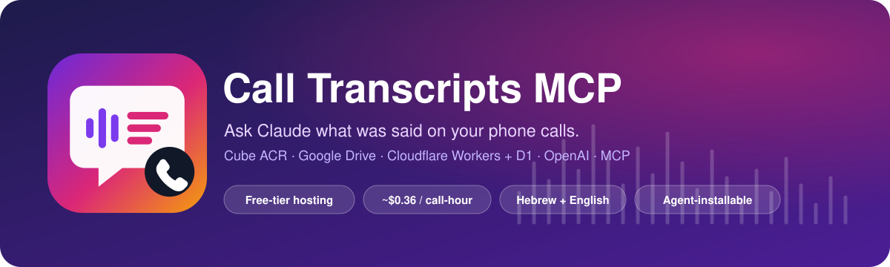
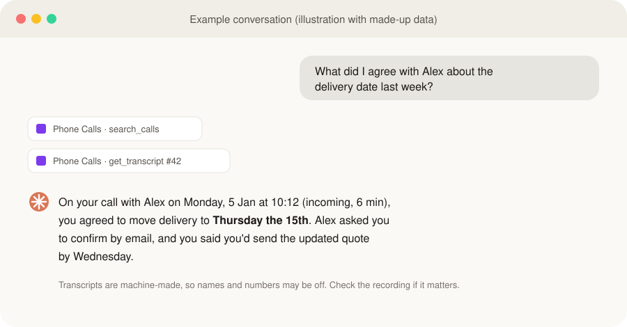
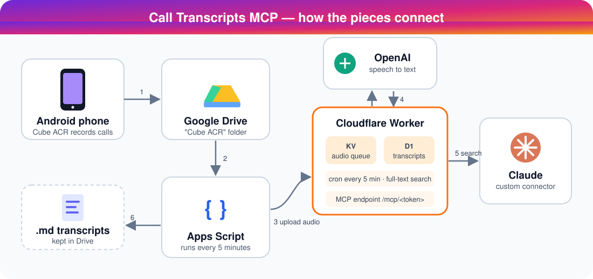
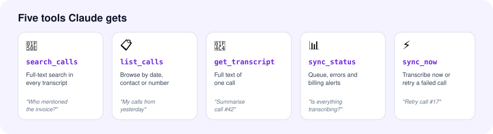
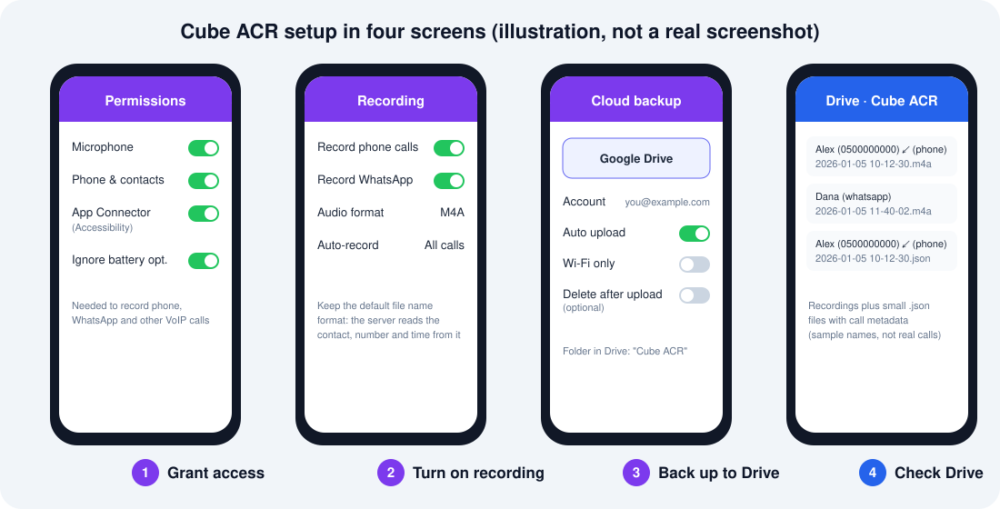
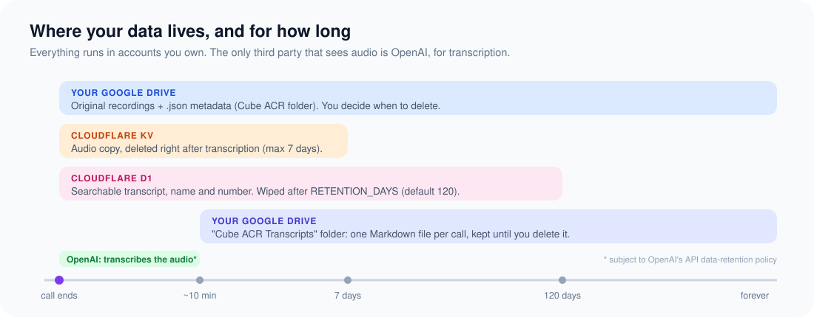

<p align="center">
  
</p>

<p align="center">
  <b>English</b> · <a href="README.he.md">עברית</a> · <a href="AGENTS.md">Setup guide for AI agents</a>
</p>

Record your phone and WhatsApp calls with **Cube ACR** on Android, have them transcribed automatically by **OpenAI**, and search them from **Claude** as a custom MCP connector. Ask things like *"what did I agree with Alex about the delivery date?"* and get an answer with the call, date and time.

Everything runs in accounts you own: your Google Drive, your Cloudflare account (free tier) and your OpenAI key. The only running cost is transcription, about **$0.006 per minute** of calls.

<p align="center"></p>

> [!TIP]
> **Let your agent do it.** Open this repo in Claude Code (or any coding agent) and say:
> *"Set this up for me by following AGENTS.md."* The agent runs the commands and stops to ask you only for the steps a human must do: the phone app, sign-ins and the API key.

---

## How it works

<p align="center"></p>

1. **Cube ACR** records each call on your Android phone and uploads it to a **Google Drive** folder.
2. A small **Google Apps Script** in your Google account checks that folder every 5 minutes.
3. It sends new recordings to a **Cloudflare Worker**, which queues the audio in **KV**.
4. Every 5 minutes the Worker transcribes the queue with **OpenAI** (`gpt-4o-transcribe`, falling back to `whisper-1` for long calls) and stores the text in **D1** with full-text search. The audio is then deleted from KV.
5. **Claude** connects to the Worker's MCP endpoint and gets five tools.
6. The Apps Script also saves every transcript back to Drive as a Markdown file, so you keep a permanent copy.

<p align="center"></p>

## What you need

| | Cost | Notes |
|---|---|---|
| Android phone with [Cube ACR](https://play.google.com/store/apps/details?id=com.catalinagroup.callrecorder) | Cloud backup needs Cube ACR Premium | iPhone can't record calls this way |
| Google account | Free | Drive + Apps Script |
| [Cloudflare](https://dash.cloudflare.com/sign-up) account | Free tier is enough | Workers, D1, KV |
| [OpenAI API key](https://platform.openai.com/api-keys) with credit | ~$0.36 per hour of calls | `gpt-4o-mini-transcribe` halves it |
| Claude plan that supports custom connectors | | Settings → Connectors |
| Node.js 18+ on your computer | Free | Only to deploy |

> [!IMPORTANT]
> **Recording law.** Recording calls is regulated differently around the world. In some places every participant has to agree. Check the rules where you and the people you call live, and tell them when needed.

---

## Setup

The whole setup takes about 30 minutes. Step 1 happens on your phone and step 5 in Claude. An agent can do steps 2 to 4 for you, stopping only for sign-ins and keys (see [AGENTS.md](AGENTS.md)).

### 1. Cube ACR on your phone

<p align="center"></p>

1. Install **Cube ACR** from Google Play and open it.
2. **Grant access.** Allow microphone, phone and contacts. When asked, turn on the **Cube ACR App Connector** in Android's *Accessibility* settings. It's needed to record WhatsApp and other VoIP calls. Also let the app ignore battery optimisation, or Android may stop it in the background.
3. **Turn on recording.** In Cube ACR's settings, make sure phone calls (and WhatsApp, if you want it) are recorded automatically. Keep the **default file name format**. The server reads the contact name, number, direction and time from names like `Alex (0500000000) ↙ (phone) 2026-01-05 10-12-30.m4a`.
4. **Back up to Google Drive.** In *Settings → Cloud backup* (wording varies a little between versions), pick **Google Drive**, sign in with the Google account you'll use for the Apps Script, and turn on automatic upload. *Delete after upload* is optional: the server works either way, and turning it on saves space on the phone.
5. **Check Drive.** Make a short test call. Within a few minutes a **Cube ACR** folder should appear in Drive with an `.m4a` recording (and often a small `.json` file beside it). Open the folder and copy its **folder id**, the last part of the URL: `drive.google.com/drive/folders/`**`THIS_PART`**.

> [!NOTE]
> Menu names in Cube ACR change between versions. If you can't find an option, look under *Settings* for *Cloud*, *Backup* or *Google Drive*.

### 2. Deploy the Worker (Cloudflare)

```bash
git clone https://github.com/Ben-Rotenberg/call-transcripts-mcp.git
cd call-transcripts-mcp
npm install
npx wrangler login                                        # opens a browser to sign in to Cloudflare

npx wrangler kv namespace create call-transcripts-audio   # copy the "id" it prints
npx wrangler d1 create call-transcripts                   # copy the "database_id" it prints
```

Open `wrangler.jsonc` and replace `<YOUR_KV_NAMESPACE_ID>` and `<YOUR_D1_DATABASE_ID>` with those two ids. If your calls aren't in Hebrew, change `TRANSCRIBE_LANGUAGE` too (`en`, `es`, ...).

Then add the secrets and deploy:

```bash
npm run token                              # prints a random 64-character token: save it
npx wrangler secret put MCP_TOKEN          # paste that token
npx wrangler secret put OPENAI_API_KEY     # paste your OpenAI key (sk-...)
npx wrangler deploy                        # prints your Worker URL
```

The deploy prints a URL like `https://call-transcripts-mcp.<your-subdomain>.workers.dev`. Open it in a browser: you should see *"Phone Calls MCP is running."* The database tables are created automatically on first use.

### 3. Install the Apps Script (Google)

1. Go to [script.google.com](https://script.google.com) with the **same Google account** Cube ACR uploads to, and click **New project**. Name it, for example, *Cube ACR Transcripts Sync*.
2. Replace the contents of `Code.gs` with [`apps-script/Code.gs`](apps-script/Code.gs).
3. Under *Project Settings* (gear icon), tick **Show "appsscript.json" manifest file in editor**, then replace that file with [`apps-script/appsscript.json`](apps-script/appsscript.json). Change `timeZone` to yours if you like.
4. Still in *Project Settings*, add these **Script Properties**:

   | Property | Value |
   |---|---|
   | `WORKER_URL` | your Worker URL from step 2 |
   | `MCP_TOKEN` | the token from step 2 |
   | `DRIVE_FOLDER_ID` | the folder id from step 1 |
   | `ALERT_EMAIL` | *(optional)* where to email you if OpenAI runs out of credit |

5. Back in the editor, choose the `setup` function in the toolbar and click **Run**. Approve the permissions Google asks for. This runs a first sync and installs a trigger that runs every 5 minutes.

The first run looks back 120 days, so a large backlog takes a while to work through (about 10 recordings every 5 minutes).

### 4. Check it works

After 5 to 10 minutes, open `https://<your-worker-url>/ingest/<MCP_TOKEN>/health`. You should see `"alert": null` and a `pending` count that goes down over time. The Apps Script *Executions* page should show successful runs.

### 5. Connect Claude

In Claude go to **Settings → Connectors → Add custom connector**, name it *Phone Calls*, and use this URL:

```
https://call-transcripts-mcp.<your-subdomain>.workers.dev/mcp/<MCP_TOKEN>
```

Then try: *"List my calls from today"* or *"Search my calls for 'invoice'"*.

> [!CAUTION]
> The connector URL contains your token, and the token is the key to every transcript. Don't share it, screenshot it or commit it. If it leaks, run `npx wrangler secret put MCP_TOKEN` with a new token and update the Apps Script property and the connector.

---

## Your data

<p align="center"></p>

- **Recordings** stay in your Drive. The Worker keeps an audio copy in KV only until it is transcribed (at most 7 days).
- **Transcripts** live in D1 for `RETENTION_DAYS` (default 120), then the text, name and number are deleted. The Markdown copies in Drive's *Cube ACR Transcripts* folder stay until you delete them.
- **Secrets** (`OPENAI_API_KEY`, `MCP_TOKEN`) are stored only as Cloudflare secrets and Apps Script properties, never in this repo.

## Settings

Change these in `wrangler.jsonc` (then `npx wrangler deploy`) or in the Cloudflare dashboard under *Worker → Settings → Variables*:

| Variable | Default | What it does |
|---|---|---|
| `TRANSCRIBE_MODEL` | `gpt-4o-transcribe` | `gpt-4o-mini-transcribe` is about half the price |
| `TRANSCRIBE_LANGUAGE` | `he` | ISO-639-1 code of your calls' language |
| `RETENTION_DAYS` | `120` | how long transcripts stay searchable |
| `BATCH_SIZE` | `10` | recordings per 5-minute run; keep it equal to `MAX_FILES_PER_RUN` in `Code.gs` |

The alert email and the Markdown headings the Apps Script writes are in Hebrew. Edit `checkOpenAiHealth` and `transcriptMarkdown` in `Code.gs` to change them.

## When something goes wrong

| Symptom | What to check |
|---|---|
| Nothing appears in Claude | Ask Claude to run `sync_status`. Check the Apps Script *Executions* page for errors. |
| *"OpenAI refused the request"* warning | Your OpenAI key is invalid or out of credit. Add credit; waiting recordings are transcribed automatically within minutes. |
| No recordings in Drive | Cube ACR backup is off, or Android is restricting the app in the background (battery optimisation). |
| A call failed 3 times | Ask Claude: *"retry call #N"* (`sync_now` with `retry_id`). |
| Names or numbers look wrong | Transcription is automatic and doesn't separate speakers; check the recording when it matters. |

Logs: Cloudflare → your Worker → *Observability*; Apps Script → *Executions*.

## Limits

- Files over 25 MB (OpenAI's limit) are registered but not transcribed. Calls over ~23 minutes use `whisper-1`.
- Cloudflare's free KV allows 1,000 writes a day, which is plenty for normal use.
- A transcript is usually ready within about 10 minutes of the recording reaching Drive.
- Claude picks connector icons from the domain's favicon, so on `workers.dev` the connector shows a generic icon. A custom domain fixes that.

## Advanced

**No Apps Script.** The Worker can also pull recordings straight from Drive with a Google service account. Share the Cube ACR folder with the service account, set `DRIVE_FOLDER_ID` in `wrangler.jsonc`, and add the key with `npx wrangler secret put GOOGLE_SERVICE_ACCOUNT_JSON`. In this mode transcripts aren't saved back to Drive as Markdown.

**Manual upload.** POST any audio file to `/upload/<MCP_TOKEN>` (multipart field `file`) to transcribe it right away.

## Repository layout

```
src/index.js            Cloudflare Worker: MCP server, ingest API, cron transcription
wrangler.jsonc          Worker config (fill in your KV and D1 ids)
schema.sql              D1 schema, for reference (the Worker creates it itself)
apps-script/            Google Apps Script that moves audio and transcripts
assets/                 Connector icon
docs/images/            Diagrams and illustrations used in this README
AGENTS.md               Step-by-step setup for an AI coding agent
```

## License

[MIT](LICENSE)
